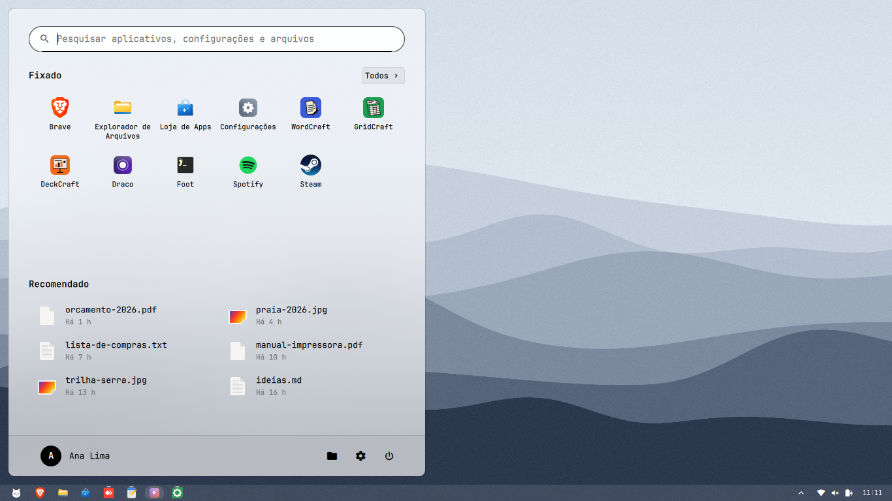
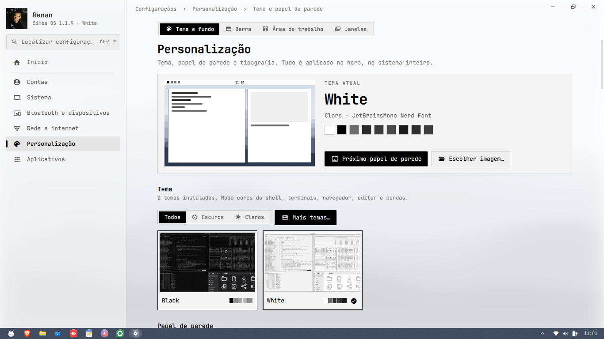
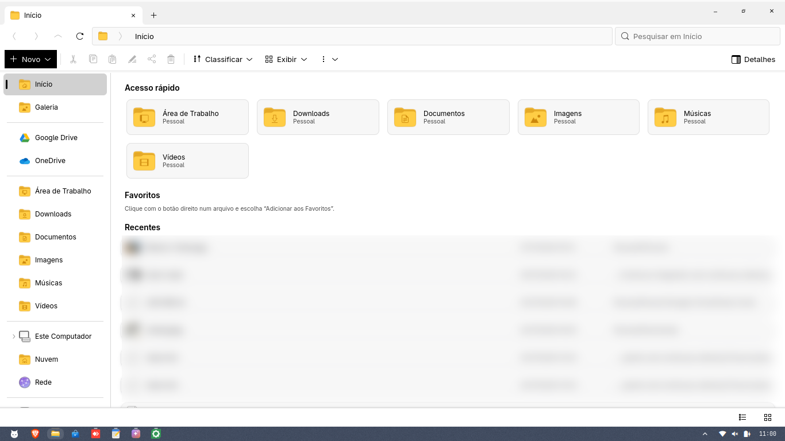
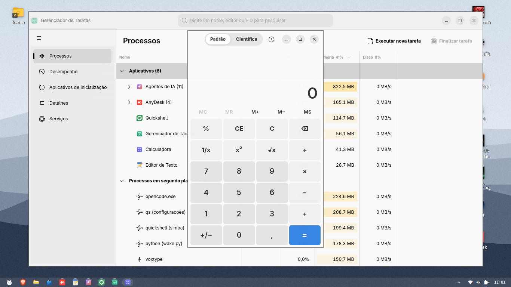

<div align="center">

<picture>
  <source media="(prefers-color-scheme: dark)" srcset="docs/imagens/banner-escuro.png">
  <source media="(prefers-color-scheme: light)" srcset="docs/imagens/banner-claro.png">
  
</picture>

<p>
Distribuição baseada no Arch Linux, com Hyprland e uma área de trabalho completa:<br>
barra de tarefas, Menu Iniciar, Configurações e aplicativos próprios, em português.
</p>

<p>
<a href="https://archlinux.org"></a>
<a href="https://hyprland.org"></a>
<a href="https://quickshell.org"></a>
<a href="LICENSE"></a>
</p>

<p>
<a href="https://sourceforge.net/projects/simba-os/files/0.1.4/"></a>
</p>

<p>
<a href="docs/INSTALAR.md"><b>Como instalar</b></a> &nbsp;·&nbsp;
<a href="#instalação"><b>Instalação</b></a> &nbsp;·&nbsp;
<a href="#capturas-de-tela"><b>Capturas de tela</b></a> &nbsp;·&nbsp;
<a href="#desenvolvimento"><b>Desenvolvimento</b></a> &nbsp;·&nbsp;
<a href="#licença"><b>Licença</b></a>
</p>

<br>



</div>

<br>

## Sobre

O Simba OS é um Arch Linux pronto para usar no dia a dia. Por baixo, é o Arch de sempre:
`pacman`, AUR e atualizações contínuas. Por cima, o Hyprland roda uma área de trabalho
organizada do jeito que a maioria das pessoas já conhece. Configurações comuns, como tela,
rede, som, temas e contas, são feitas por aplicativos, sem editar arquivos de texto.

Todo o sistema está em português do Brasil, com inglês como segunda opção. Cada parte é
um pacote pacman comum, com atualizações assinadas.

> [!NOTE]
> **Versão 0.1.4 (beta).** A ISO está disponível para
> [download](https://sourceforge.net/projects/simba-os/files/0.1.4/) e o passo a passo está em
> [docs/INSTALAR.md](docs/INSTALAR.md). Foi testada em máquina virtual e em poucos computadores:
> relatos de problemas nas [Issues](https://github.com/renanjsilv/simba-os/issues) ajudam muito.

## O que vem no sistema

**Área de trabalho.** Barra de tarefas com prévia das janelas, Menu Iniciar com busca de
apps, configurações e arquivos, bandeja do sistema, central de notificações, tela de
bloqueio e tema de boot (Plymouth) próprios.

**Aplicativos.**

| Aplicativo | Função |
|---|---|
| Configurações | Tela, som, rede, Bluetooth, contas, temas, papel de parede, barra e janelas |
| Explorador de Arquivos | Acesso rápido, favoritos, abas, Google Drive e OneDrive |
| Gerenciador de Tarefas | Processos, desempenho, aplicativos de inicialização e serviços |
| Agentes de IA | Chat para Claude Code, Codex, Gemini e outros, com voz e navegador embutido |
| Draco | Assistente de voz com palavra de ativação, Whisper e vozes Piper/Edge |
| Transcrever | Converte áudio em texto localmente, com Whisper |
| Gerar ISO | Cria uma ISO instalável da máquina: clone pessoal ou versão distribuível, sem dados pessoais |
| Calculadora, Boas-vindas, Loja de Apps | Ferramentas do dia a dia e primeiros passos |

**Sistema.** O instalador detecta a placa NVIDIA e escolhe o driver certo, além do
microcódigo Intel ou AMD. O **Atualizar tudo** atualiza Arch, AUR e Simba de uma vez.
Também há pontos de restauração e backup no Google Drive.

## Capturas de tela

<table>
  <tr>
    <td width="50%"></td>
    <td width="50%"></td>
  </tr>
  <tr>
    <td align="center"><sub>Configurações: temas, papel de parede e tipografia</sub></td>
    <td align="center"><sub>Explorador de Arquivos</sub></td>
  </tr>
  <tr>
    <td width="50%"></td>
    <td width="50%"></td>
  </tr>
  <tr>
    <td align="center"><sub>Gerenciador de Tarefas e Calculadora</sub></td>
    <td align="center"><sub>Um dos papéis de parede do sistema</sub></td>
  </tr>
</table>

<details>
<summary><b>Papéis de parede</b></summary>
<br>

O sistema vem com 18 papéis de parede próprios, claros e escuros.

<table>
  <tr>
    <td></td>
    <td></td>
    <td></td>
  </tr>
  <tr>
    <td></td>
    <td></td>
    <td></td>
  </tr>
</table>
</details>

## Instalação

### Pela ISO

**[Baixar o Simba OS 0.1.4](https://sourceforge.net/projects/simba-os/files/0.1.4/)** (4,4 GB, x86_64, UEFI)

O passo a passo completo, do download ao primeiro uso, está em **[docs/INSTALAR.md](docs/INSTALAR.md)**:
conferir o download, gravar o pendrive, dar boot, as perguntas do instalador e problemas comuns.

| | |
|---|---|
| Arquivo | `simba-os-0.1.4-x86_64.iso` |
| Tamanho | 4,4 GB |
| SHA-256 | `a2f918e51f3b34615ab0ae7a53387542358aeadf1c97a1fd396ec18ed4f6085f` |
| Requisitos | x86_64, UEFI, Secure Boot desligado, disco de 25 GB ou mais (todo apagado) |

### Num Arch Linux já instalado

Adicione o repositório ao `/etc/pacman.conf`:

```ini
[simba-os]
SigLevel = Required DatabaseRequired
Server = https://github.com/renanjsilv/simba-os/releases/download/repo
```

Depois instale os pacotes:

```bash
sudo pacman -Sy simba-keyring
sudo pacman -S simba simba-apps simba-draco
simba-apps-usuario        # uma vez por usuário
```

> [!IMPORTANT]
> O pacote `simba` substitui boa parte da configuração do Hyprland. Num sistema que já tem
> configurações próprias, faça backup de `~/.config/hypr` antes de instalar.

## Pacotes

| Pacote | Conteúdo |
|---|---|
| `simba` | Base do sistema: barra, menus, notificações, scripts `simba-*`, temas, `/etc/skel` e tradução |
| `simba-apps` | Configurações, Menu Iniciar, Explorador, Gerenciador de Tarefas, Agentes de IA, Transcrever, Gerar ISO, módulos da barra, tela de bloqueio e idiomas |
| `simba-draco` | Assistente de voz Draco. O ambiente Python e as vozes são preparados para cada usuário |
| `simba-keyring` | Chave pública que assina os pacotes e a seção `[simba-os]` do `pacman.conf` |

## Desenvolvimento

Cada `pacotes/<pacote>/raiz/` espelha o sistema instalado: `raiz/usr/bin/x` vira `/usr/bin/x`.

```bash
# edite em pacotes/<pacote>/raiz/ e suba pkgver/pkgrel no PKGBUILD
ferramentas/construir simba-apps                 # gera dist/simba-apps-*.pkg.tar.zst
sudo pacman -U dist/simba-apps-*.pkg.tar.zst     # instala e testa localmente

ferramentas/publicar                             # assina e envia ao canal de TESTE
ferramentas/promover                             # leva os mesmos arquivos ao canal estável
```

Toda atualização passa primeiro pelo canal de teste (`[simba-os-testing]`, release `repo-testing`).
Numa VM ou máquina de teste, `simba-canal teste` + **Atualizar tudo**; se estiver tudo certo,
`ferramentas/promover` copia exatamente os pacotes testados (sem recompilar) para o `[simba-os]`.
`ferramentas/publicar --direto` pula o teste: só para emergências, como correção de segurança.
`ferramentas/verificar-aur` avisa quando um pacote do AUR republicado (ex.: `brave-bin`) tem versão nova.

Na primeira publicação, rode `ferramentas/criar-chave` para gerar a chave GPG de assinatura.
A chave privada fica só na máquina de quem publica.

Testes do chat de Agentes de IA:

```bash
python3 -m unittest discover -s testes/agentes   # parser e markdown
testes/agentes/janela_integracao.sh              # janela GTK real, sem abrir nada na tela
```

<details>
<summary><b>Traduções</b></summary>
<br>

Os textos dos aplicativos próprios ficam em catálogos JSON em
`pacotes/simba-apps/raiz/usr/share/simba-apps/idiomas/`, com o texto em português como chave.
Para adicionar um idioma, crie um novo `.json` nessa pasta. O `LEIA-ME.md` da pasta explica
as ferramentas `extrair.py`, `marcar.py` e `conferir.py`.
</details>

## Créditos

O Simba OS existe graças a [Arch Linux](https://archlinux.org), [Hyprland](https://hyprland.org)
e [Quickshell](https://quickshell.org). A base do pacote `simba` deriva do
[Omarchy](https://github.com/basecamp/omarchy), da Basecamp.

## Licença

Distribuído sob a licença [MIT](LICENSE). A parte derivada do Omarchy mantém o aviso
original em [`NOTICE`](NOTICE) e [`LICENSES/omarchy-MIT.txt`](LICENSES/omarchy-MIT.txt).
